# Pokémon — Kotlin Multiplatform

A small but production-shaped Pokédex app built with **Kotlin Multiplatform**. All domain, data, networking, persistence and presentation logic lives in a single shared module, while each platform keeps its own native UI: **Jetpack Compose** on Android and **SwiftUI** on iOS.

> Data comes from the public [PokéAPI](https://pokeapi.co). You can browse the Pokédex, open a detail page, and build a team of up to six Pokémon that survives app restarts.

---

## ✨ Features

- **Pokédex** — paginated, infinite-scrolling grid with cached artwork and shimmer placeholders while loading.
- **Detail** — type, weight/height, abilities, base stats and a shiny toggle, with a type-tinted background.
- **Team** — add/remove Pokémon (max 6), persisted locally; empty, partial and full states are all handled.
- **Settings** — metric/imperial units, 12/24-hour time, and light/dark/system theme.
- **Resilient UX** — offline error screen with retry, transient errors surfaced via snackbar, adaptive layouts for portrait, landscape and larger screens.

---

## 📱 Screenshots

| Pokédex | Detail | Team |
| :---: | :---: | :---: |
| 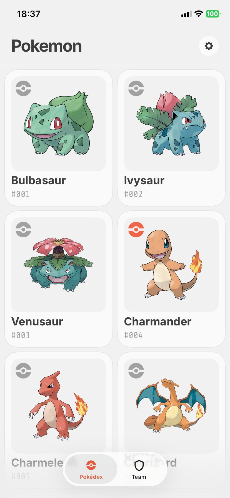 | 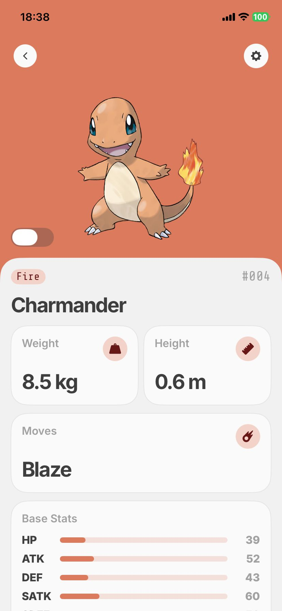 | 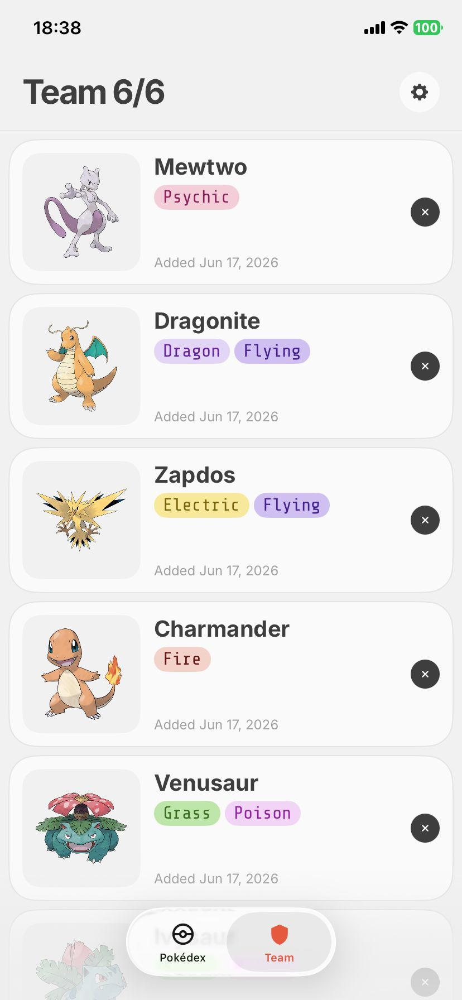 |
| Infinite grid + cached art | Stats, abilities & shiny toggle | Up to 6, persisted locally |

| Settings | Loading | Offline |
| :---: | :---: | :---: |
| 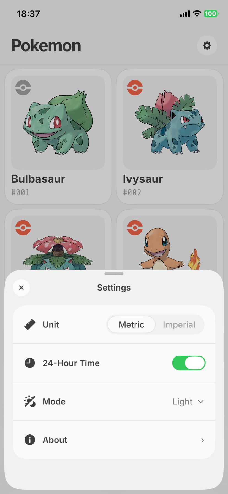 | 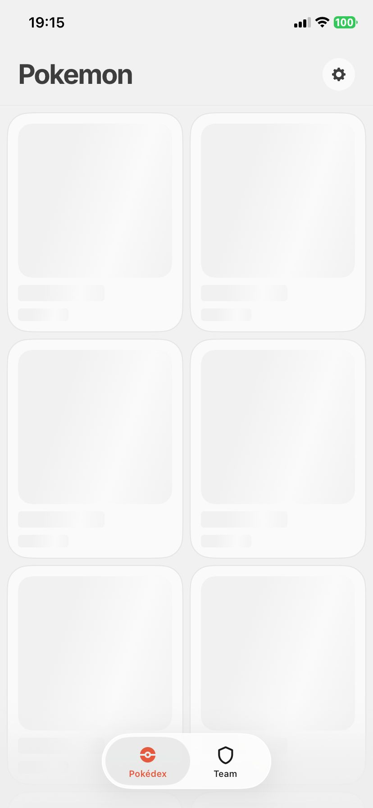 | 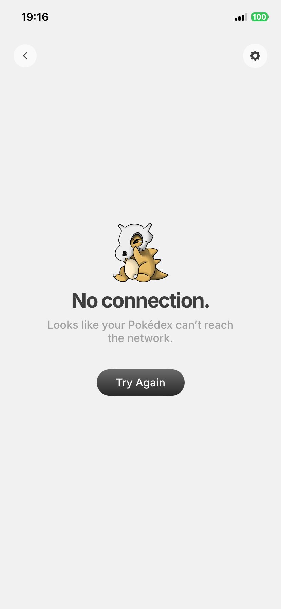 |
| Units · time · theme | Shimmer placeholders | Error state + retry |

<details>
<summary>More — dark mode, adaptive layout & states</summary>

| Detail (dark) | Settings (dark) | Adaptive grid |
| :---: | :---: | :---: |
| 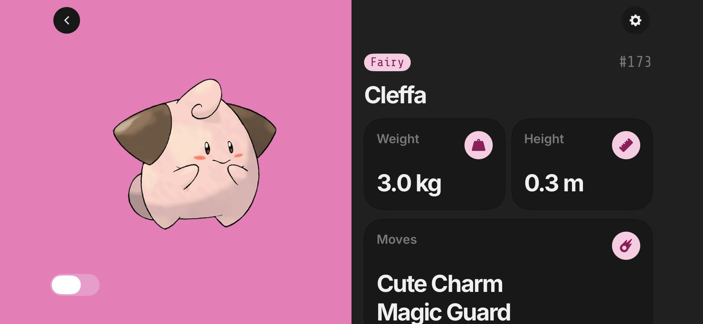 | 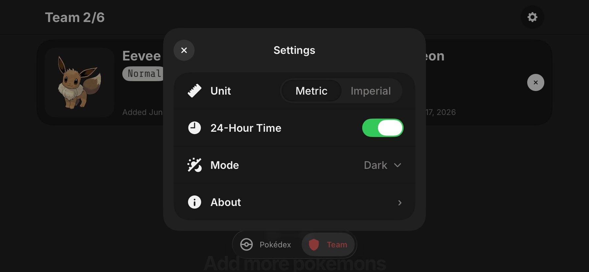 | 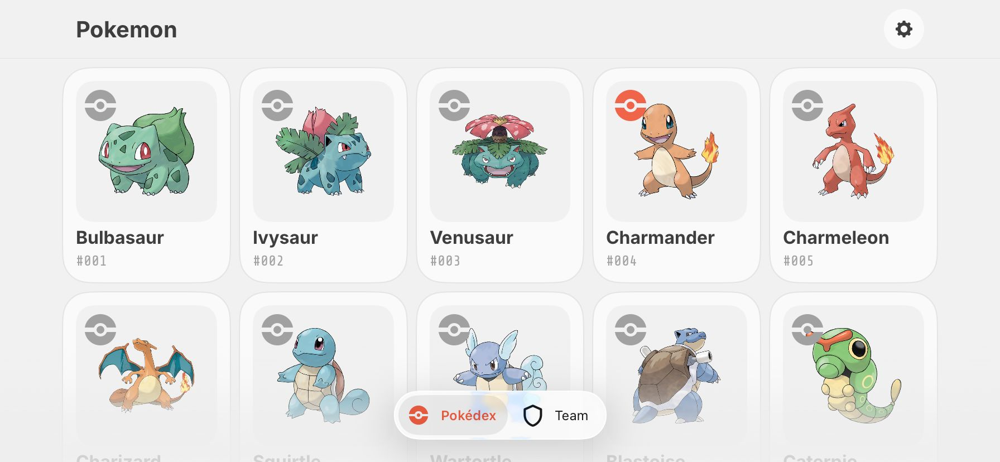 |

| Team full | Snackbar | Empty team |
| :---: | :---: | :---: |
| 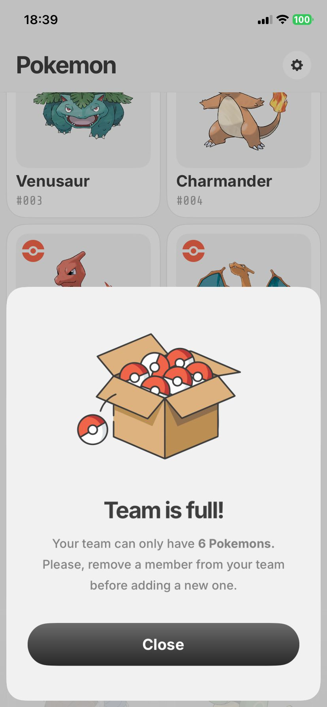 | 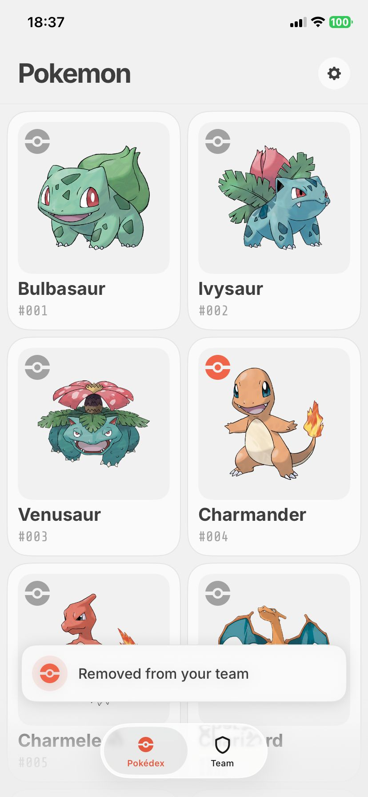 | 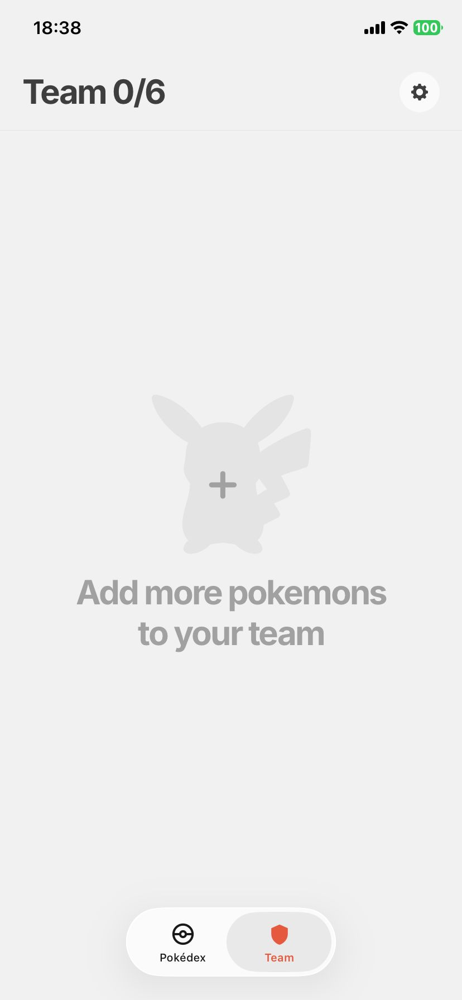 |

</details>

---

## 🏛️ Architecture

Clean architecture with a unidirectional MVVM/MVI flow. The shared module exposes `ViewModel`s that emit immutable UI state; each platform renders that state natively.

```
┌───────────────────────────┐     ┌───────────────────────────┐
│   androidApp (Compose)    │     │     iosApp (SwiftUI)      │
└─────────────┬─────────────┘     └─────────────┬─────────────┘
              │            observe state         │
              └───────────────┬──────────────────┘
                              ▼
        ┌─────────────────────────────────────────┐
        │            shared (commonMain)            │
        │                                           │
        │  presentation  → ViewModels + UI state    │
        │  domain        → models · repositories ·  │
        │                  use cases                │
        │  data          → remote (Ktor) · local    │
        │                  (SQLDelight) · mappers    │
        │  core          → di · network · db · prefs │
        └─────────────────────────────────────────┘
```

- **Single source of truth** — repositories merge the PokéAPI network layer with the SQLDelight cache.
- **Platform-agnostic shared code** — no Android/iOS types leak into `commonMain`.
- iOS consumes the shared `ViewModel`s through [KMP-ObservableViewModel](https://github.com/rickclephas/KMP-ObservableViewModel) (`@StateViewModel`), so SwiftUI observes Kotlin state idiomatically.

---

## 🧰 Tech Stack

| Layer | Choice |
| --- | --- |
| Language | Kotlin 2.4, Swift |
| Shared logic | Kotlin Multiplatform, Coroutines & Flow |
| Android UI | Jetpack Compose (Material 3, Adaptive) |
| iOS UI | SwiftUI + Kingfisher (image cache) |
| Networking | Ktor Client + kotlinx.serialization |
| Persistence | SQLDelight |
| Preferences | DataStore (Android) |
| DI | Koin |
| Images | Coil 3 (Android) |
| Navigation | Compose Navigation (Android) |
| Testing | kotlin.test · Coroutines Test · Turbine |

---

## 📂 Module Structure

```
Pokemon/
├── shared/        # KMP: domain, data, networking, database, presentation
├── androidApp/    # Jetpack Compose UI, navigation, design system
├── iosApp/        # SwiftUI UI, DI bridge, native integrations
└── docs/          # screenshots & assets
```

---

## 🚀 Getting Started

**Requirements:** JDK 17+, Android Studio (latest), Xcode 15+ for iOS.

**Android**

```bash
./gradlew :androidApp:assembleDebug
```

Or open the project in Android Studio and run the `androidApp` configuration.

**iOS**

Open `iosApp/iosApp.xcodeproj` in Xcode and run on a simulator or device.

**Tests**

```bash
./gradlew :shared:allTests
```

---

## 📄 License

Built as a portfolio / assignment project. Pokémon data and artwork are © Nintendo / Game Freak, served via [PokéAPI](https://pokeapi.co).
